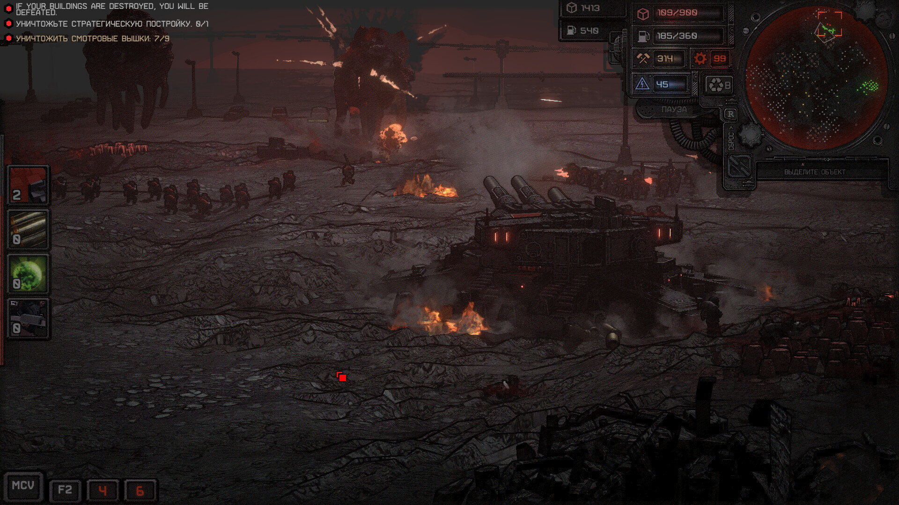

# Dust Front RTS 中文翻译补丁



这是 Dust Front RTS Windows 版的中文翻译补丁项目，针对 Unity `2020.3.3f1` 制作。

## 直接安装

从 [Releases](https://github.com/Mios-dream/dust-front-rts-chinese-patch/releases/latest) 下载最新的 `Dust Front RTS Chinese Patch.7z`，解压后在 PowerShell 中执行：

```powershell
Set-ExecutionPolicy -Scope Process Bypass
.\install.ps1 -GamePath "C:\Program Files (x86)\Steam\steamapps\common\Dust Front RTS"
```

卸载并恢复原文件：

```powershell
.\uninstall.ps1 -GamePath "C:\Program Files (x86)\Steam\steamapps\common\Dust Front RTS"
```

安装脚本会校验游戏资源版本，并在替换前创建备份。Steam 更新游戏后，旧补丁会被拒绝安装；请等待对应版本的补丁，不要随意使用 `-Force`。

## 已翻译内容

- 教程本地化表：70 条
- 主本地化表：635 条
- 主菜单、设置、任务、单位、建筑、能力、学说和装备描述
- TextMeshPro 中文 fallback 字体

补丁针对的原始 `resources.assets` SHA-256：

```text
9942986e756fc44701cd1c1e64f5c49b52a40367b5efa86b69261d7f3342d723
```

## 项目内容

仓库只保存翻译表、构建脚本、安装脚本和字体构建资源，不包含游戏 EXE、DLL、Unity 资源、反编译输出或测试副本。可直接使用的修改后 `resources.assets` 仅作为 Release 附件提供。

如果要重新构建，需要自行准备与目标版本匹配的游戏副本，并将由 Il2CppDumper 生成的 `DummyDll` 放入 `tools/vendor/Il2CppDumper/DummyDll/`。原始游戏文件不应提交到仓库。

```powershell
uv sync
uv run python .\tools\subset_font.py
uv run python .\tools\build_patch.py
```

构建结果会写入被 Git 忽略的 `dist/` 目录。构建依赖包括 UnityPy、TypeTreeGeneratorAPI 和 fontTools，版本已固定在 `pyproject.toml`。

## 许可证与版权

项目中的脚本和翻译数据使用 MIT 协议，见 [LICENSE](LICENSE)。字体使用 Noto Sans CJK SC，遵循 SIL Open Font License 1.1，见 [`tools/assets/OFL.txt`](tools/assets/OFL.txt)。

原游戏、原始游戏资源以及 Release 中由游戏资源修改而来的补丁文件仍属于其原版权持有人。本项目不授予原游戏的任何权利；请仅对自己合法拥有的游戏安装使用补丁。
